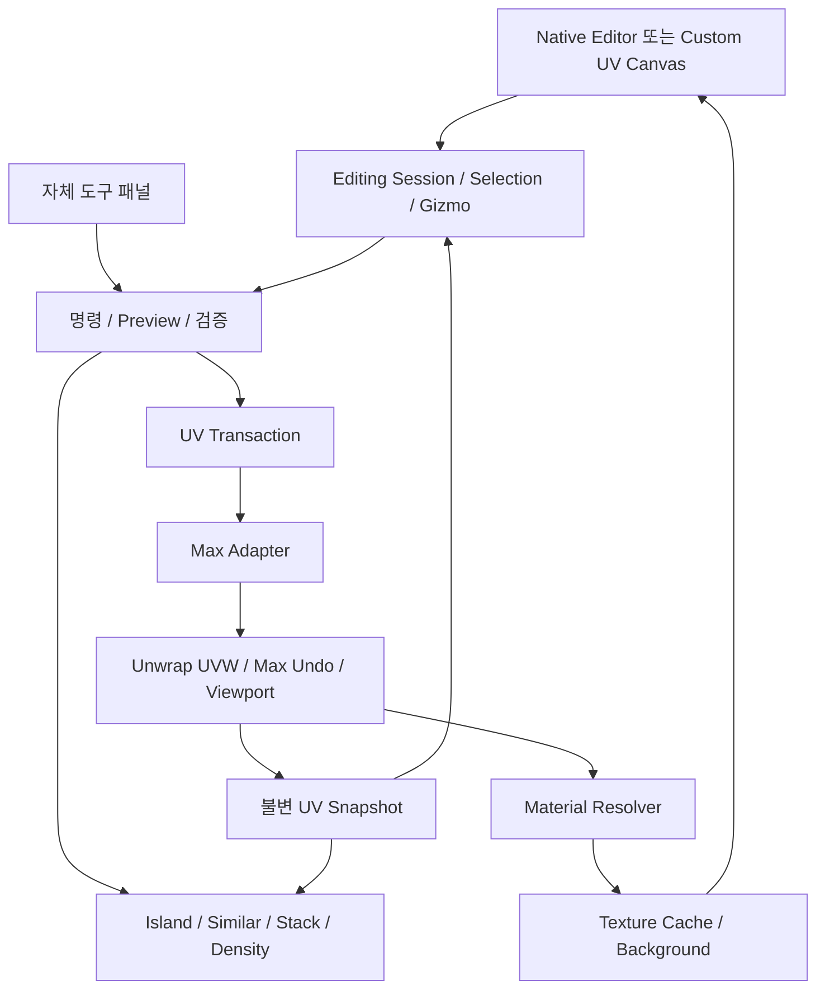

# LSY UV Repair — 아키텍처

아래 A/B/C 비교와 모듈 표는 초기 설계다. 현재는 `v1/LSY_UV_Workbench.ms`의 native 세로 패널과 일부 canonical helper가 구현됐다. 실제 구조 평가·수정 방향은 [전체 리뷰](REVIEW_2026-10-14.md)를 따른다. 사용자가 거절한 custom canvas 경로는 현재 실행 계획에서 제외했다. API 근거는 [TECHNICAL_FEASIBILITY.md](TECHNICAL_FEASIBILITY.md)를 참조한다.

## A/B/C 비교와 결정

| 기준 | A Native Extension | B Hybrid | C Custom Editor |
|---|---|---|---|
| 편집 화면 | 기존 Unwrap 화면 | 기존 화면 + 자체 패널, 필요 시 교체 | PySide 별도 UV 화면 |
| UV 저장 | Unwrap | Unwrap | 역시 Unwrap 권장 |
| 점 가시성 | 공개 설정 범위 한정 | native 제한 동일, canvas 추가로 확장 | 점/선/Hover 자유 제어 |
| 기즈모 | 기존 명령/피벗 재사용 | native 검증 후 custom 대안 가능 | 직접 입력·수학·Undo 모두 구현 |
| 개발량 | 가장 작음 | 공통 데이터 계층 비용 추가 | 선택·렌더링·기즈모 비용 큼 |
| 성능 | 네이티브 화면 유리 | bridge 호출 병합 필요 | drawing과 live bridge 둘 다 병목 후보 |
| 호환성 | API·UI context 차이 | API + PySide 어댑터 | API + Qt + 렌더러/DPI 검사 |
| 유지보수 | 작지만 native bug 의존 | 계층 분리로 경로 전환 가능 | 입력·성능·UI 회귀 테스트 많음 |
| V1 예상 인일/코드 LOC(테스트 포함) | 18–30 / 1.5–3k | native 25–40 / 2–4k | hybrid backend+custom 45–70 / 4–7k |
| 전체 토큰 예상(예비 포함) | 0.80–1.20M, 축소 위험 | native 전체충족 시 약 0.80–1.70M | 기준 1.985M, 최대 4.07M |
| 요구 충족 판정 | F01 전체/F02 미검증 | 권장 구조, 화면은 gate 결정 | 실험 통과 전까지 가능성만 확인 |

수치는 자체 추정이다. A/B-native가 요구 일부를 충족하지 못하면 저비용 완성품으로 비교할 수 없다. 최소 시나리오는 실제로 전체 요구를 통과하는 경우에만 성립한다. C도 C++ UV backend를 처음부터 새로 만드는 것을 뜻하지 않는다.

## 계층과 책임

| 예상 모듈 | 책임 |
|---|---|
| host/max_adapter | interface capability, node 명시 UV I/O, logical channel 정규화, 선택 동기화 |
| host/native_editor | native 상태·설정·map 목록 index 관리 |
| host/transaction | 쓰기 preflight, Hold 소유권, rollback, Undo/Redo 감지 |
| domain/snapshot | UV/geometry/corner/material/revision 불변 데이터 |
| domain/islands, similarity, stack, density | 호스트 의존 없는 숫자·그래프 계산 |
| materials/resolver, texture_graph | Material ID 의미론, texture 후보와 신뢰도 |
| ui/session, canvas, gizmo, panels | 입력, 화면, preview, 사용자 상태 |
| infrastructure/cache, diagnostics, settings | revision 캐시, 성능·오류 기록, 설정 |

API와 자체 메서드는 명명·문서에서 구분한다. Python에 모든 점마다 왕복시키기보다 Max 쪽에서 필요한 배열을 묶어 추출하는 어댑터를 우선 검증한다. 순수 알고리즘에는 MAXWrapper를 전달하지 않는다.

## 데이터 모델과 평가 단계

Snapshot에는 node identity, modifier identity, logical channel, time, topology revision, UVW 배열, face별 UV corner index, 대응 geometry corner index, face Material ID, world geometry 좌표, 선택, material identity, texture metadata를 둔다. MAXScript 1-based와 Python 0-based 변환은 어댑터 경계 한 곳에서만 수행한다.

같은 XYZ vertex라도 seam 때문에 여러 UV vertex일 수 있다. UV 좌표가 같아도 다른 index일 수 있다. 좌표 비교로 deduplicate하거나 weld하지 않는다. UV point ID는 topology revision 안에서만 유효하다. dead/unreferenced point는 연결 추출에서 구분하고 임의 compact하지 않는다.

**geometry와 UV의 face index는 반드시 동일한 스택 평가 단계에서 대응해야 한다.** base Editable Poly의 face index와 중간 modifier의 face index가 같다고 가정하지 않는다. V1은 최적화 결과가 안정된 최상단 Unwrap을 기본으로 한다. 같은 단계의 geometry/Material ID 조회가 입증되지 않는 스택은 진단 전용이다. 평가 mesh 삼각형 번호를 polygon 번호처럼 사용하지 않는다. 임시 평가 데이터는 원본 node를 convert/collapse하지 않고 얻으며 추출 경로 자체를 V0에서 검증한다.

V1은 유효 기존 Unwrap을 명시 선택하거나 최적화 이후 새 Unwrap을 추가하는 흐름을 제공한다. 추가 작업 자체도 Undo 대상이고 초기 UV가 그대로인지 비교한다. modifier 재정렬/자동 Collapse/reset은 하지 않는다. 아래쪽 topology가 변하면 세션 revision을 폐기하고 재읽는다. 오래된 점 index로 재적용하지 않는다.

## 드래그와 Undo 설계

네이티브 드래그는 Max가 Undo를 소유한다. 자체 numeric/Stack/TD 명령은 하나의 동기 `pymxs.undo` 블록에서 처리한다. custom 이벤트 드래그는 아래 별도 경로를 검증한다.

V1 쓰기 preflight에서 Auto Key/animated UV와 soft selection을 검사한다. 애니메이션 키 생성은 허용하지 않고 해당 상태에서는 쓰기를 차단한다. soft selection에 의한 비선택 점 이동도 V1에서는 지원하지 않으며 명시적으로 해제된 상태에서만 시작한다. 사용자의 전역 설정을 조용히 바꾸지 않는다.

1. press: 대상/선택/원좌표/revision을 잠그고 다른 Hold가 열려 있으면 시작하지 않는다. 자체 Hold를 연다.
2. move: 시작 좌표에서 계산한 delta를 검증하고, 변경 점만 main thread에서 쓴다. UV repaint/viewport refresh를 병합한다.
3. release: 최종 쓰기·무결성 검증 후 Hold Accept 한 번. 0변화 drag는 취소하여 Undo 항목을 만들지 않는다.
4. Esc/focus loss/오류: 자신이 소유한 Hold만 Cancel. 복구 결과를 snapshot과 비교하고 실패 상태를 사용자에게 표시한다.
5. Undo/Redo: 데이터·선택·배경 캐시 재읽기. native와 custom에 별도 scene Undo 스택을 만들지 않는다.

setter의 Restore 데이터 등록과 Hold 동작을 실험해야 한다. 실패하면 이벤트 사이의 안전한 preview/commit 트랜잭션을 재설계하거나 SDK RestoreObj를 검토한다. **release 시점만 반영하는 대안으로 실시간 3D 요구를 충족했다고 하지 않는다.** Qt 이벤트 여러 번에 Python context manager가 자동으로 이어진다고 가정하지 않는다.

일반 명령의 `pymxs.undo`는 예외를 삼킬 수 있으므로 결과 플래그/진단을 블록 밖에서 확인한다. 취소 실패 후 snapshot 복원도 topology가 동일할 때만 시도한다. revision이 달라졌다면 쓰기를 중단하고 Undo/저장된 씬 복구 절차를 안내한다. 프로세스 crash까지 메모리 snapshot이 복구한다고 약속하지 않는다. 개발/실사용 전 저장본을 유지하고 복구 checkpoint 기능은 V4 검토한다. [Autodesk pymxs](https://help.autodesk.com/cloudhelp/2022/ENU/Max-Python-API/using_pymxs/pymxs_module.html), [theHold](https://help.autodesk.com/cloudhelp/2024/ENU/MAXScript-Help/files/MAXScript-Tools-and-Interaction/Miscellaneous-Functions/GUID-17BFEAAF-3395-4FFB-9F98-54767481AB08.html).

## UI·이벤트 동기화

Custom canvas는 이미지·wire·selection·gizmo를 다른 layer로 렌더링한다. 초기에는 QGraphicsView와 집계 draw item을 사용하고 vertex마다 Python item 하나를 만드는 구조를 피한다. 화면상의 점/핸들 크기는 zoom 독립, UV는 v-up 기준이다. picking용 spatial grid를 재사용한다. [Qt 공식 QGraphicsView](https://doc.qt.io/qtforpython-6.8/PySide6/QtWidgets/QGraphicsView.html).

native 창과 custom 창의 동시 쓰기는 허용하지 않고 활성 편집기를 하나로 제한한다. native로 전환하면 custom drag를 취소/동기화한다. 외부 선택·Undo·node 삭제·scene reset·modifier 변경은 invalidate 이벤트로 처리한다. 구체적인 callback 이벤트 이름과 UV subselection 감지 범위는 버전별 PoC 후 확정한다. 공개 이벤트가 부족하면 활성 세션에만 100–200ms 선택 fingerprint polling을 제안한다. 매번 전체 UV를 읽지 않는다.

배경 image load는 비동기 가능하나 request revision을 붙여 오래된 완료 결과를 버린다. background lock과 manual ID가 자동 이벤트보다 우선한다. image 캐시는 경로+수정시각+tile+표시모드 기준이고 Max 재질 객체 수명은 main thread에서 관리한다.

## 무결성 정책

| 대상 | 정책 |
|---|---|
| geometry | XYZ/face-corner/topology/node transform 불변 |
| seam·UV topology | 일반 좌표 명령은 face→UV index 불변; Weld만 명시적 예외 |
| material | face ID, node.material, sub-material/texture 참조 불변 |
| channel | 선택 채널 좌표만 수정. 다른 채널/vertex color 불변 |
| stack | 순서·다른 modifier 설정 보존. 자동 Collapse 금지 |
| Collapse/Remove/Weld 이후 | 최적화 완료 상태에서 새 snapshot. 전후 index 동일성 추정 금지 |
| instancing | V1 공유 base/modifier 감지 시 쓰기 차단. V4 전체 instance 함께 편집 또는 명시 분리 선택 |
| multiple nodes | V1 단일 node. 이후 node별 snapshot/ByNode I/O, 하나의 명령 실패 시 전체 rollback |
| UDIM | UV 좌표 wrap/clamp 금지. tile/이미지 정책은 별도 |
| animated/unsupported data | V1 진단 전용, 조용한 static 변환 금지 |

## 성능·호환성 전략

목표는 50k UV points/선택 5k에서 canvas 입력 p95 33ms 이내, 3D 반영 p95 100ms 이내다. **측정값이 아닌 gate 기준**이다. 실제 GPU/CPU/Max/texture 크기를 기록한다. topology graph는 revision 동안 재사용하고 analysis는 후보 크기별 bucket을 사용한다. 대칭 graph 탐색은 시간/후보 수 제한을 두며 cancel을 지원한다.

대형 씬은 texture mip/downsample, 화면 밖 culling, 변경 점 batch, viewport refresh 제한 순서로 최적화한다. 그래도 실패하면 C++ batch bridge/renderer를 검토하고 예산을 재산정한다. Qt OpenGL 도입만으로 host UV setter 병목이 해결되지는 않는다.

호스트 동봉 PySide를 사용하며 별도 pip Qt로 Max Qt를 교체하지 않는다. qt_compat 계층에서 enum/event 차이를 흡수한다. 1개 버전 제품을 먼저 통과시킨 다음 PySide2와 PySide6 환경을 각각 검증한다. 플러그인 lifecycle은 재실행 시 단일 창, close 시 timer/callback 해제, scene 재열기 시 참조 폐기를 포함한다.
